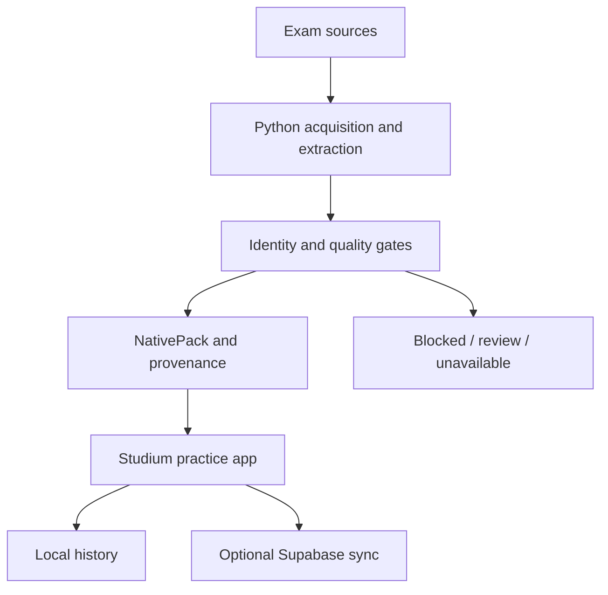

# ENEMLab / Studium

Document acquisition and validation pipelines paired with a local-first exam practice application.

**ENEMLab** is the repository's historical name; **Studium** is the application name. They are currently one codebase, not two independent portfolio projects.

## Why this exists

Exam documents have inconsistent layouts, answer-key formats, and source availability. A useful question bank must preserve document identity and refuse incomplete or mismatched content instead of silently filling gaps.

The application provides a way to use and inspect those records through practice, correction, and study history.

## What it does

- Discovers exam editions and acquires documents through provider-specific adapters.
- Extracts native text and visual question regions, with targeted OCR fallbacks.
- Normalizes question identity, answer keys, taxonomy, and source metadata.
- Gates NativePack preparation and publication on identity and quality checks.
- Tracks source health and publishes through an OIDC-protected broker.
- Supports practice, correction, spaced review, and local study history, with optional Supabase synchronization.

## Pipeline

**Discovery → Acquisition → Extraction → Enrichment**

| Stage | Responsibility | Entry points |
| --- | --- | --- |
| Discovery | Edition/source inventory and adapter eligibility | `scripts/native_ingest.py`, `scripts/native_orchestrator.py` |
| Acquisition | Source download, audit metadata, document hashing | `scripts/native_prepare.py`, provider ingestion scripts |
| Extraction | Native text, markers, page rendering and visual regions | `scripts/native_pipeline.py`, `native_option_markers.py`, `native_ocr_markers.py` |
| Enrichment | Provider identity, answer pairing, taxonomy and review evidence | `src/lib/providers/`, `src/lib/native/` |
| Publication | Quality gates, health reports and authenticated upload | `scripts/native_fleet.py`, `supabase/functions/native-fleet-publisher/` |

The public inventory distinguishes eligible targets from blocked targets. A registered provider is not evidence that its documents have been completely extracted.

## Architecture



See [the NativePack contracts](src/lib/native/contracts.ts) and [pipeline details](docs/native-content-pipeline.md).

## Data validity and provenance

A usable question needs its content, alternatives, and correctly paired answer. Native content may retain visual regions as the canonical representation while semantic text remains incomplete.

Document records carry source URL, SHA-256, byte count, page count, provider, edition, and phase. Extraction records carry parser version, method, detected markers/options, issues, and visual completeness evidence. Stable question keys are audited against executable provider implementations.

Draft/review records are distinct from approved/published records. Fleet gates reject unresolved extraction or identity problems; source health includes healthy, degraded, unavailable, and pending states. Failed or missing sources are not permission to invent questions.

These gates do not prove universal parser correctness, complete exam coverage, or redistribution rights.

## Tech stack

Python 3.12, TypeScript, Next.js, React, Zustand, Zod, Vitest, Playwright, Supabase, PyMuPDF/Pillow, and optional Tesseract OCR.

Python pipeline tests use the standard-library `unittest` runner. This is not a Python API backend.

## Getting started

```bash
git clone https://github.com/macielhgustavo/enemlab.git
cd enemlab
npm ci
npm run dev
```

Open http://localhost:3000. Use Node.js 22; Python 3.12 is needed for pipeline tests. PDF preparation additionally needs PyMuPDF and Pillow; OCR paths need Tesseract.

```bash
python scripts/native_ingest.py inventory
python scripts/native_prepare.py --help
```

Inventory is an inspection command; preparing real documents can require network access and optional dependencies.

Cloud configuration is described in `.env.example` and `supabase/VERIFICAR-RLS.md`. The frontend currently includes defaults for the canonical Supabase project. Configure your own project before testing authentication or synchronization.

## Tests

```bash
npm test
npm run lint
npm run build
```

Python-only regression tests:

```bash
python -m unittest discover -s scripts/tests -p 'test_*.py'
```

Playwright uses the Chrome channel:

```bash
npx playwright install chrome
npm run test:e2e:ci
```

Application CI covers tests, lint, build, Storybook, and browser checks. Native Fleet has a separate workflow and publication responsibility.

## Technical decisions

- **Provider-specific identity:** editions and phases remain explicit; records from different exams must not share history accidentally.
- **Native text before OCR:** deterministic parsing is preferred; layout ambiguity stays visible in review.
- **Visual content remains canonical:** page coordinates preserve figures and shared context when semantic extraction is insufficient.
- **Local-first history:** the legacy `enem_lab_v7` storage key is retained to avoid silently losing user state.

## Limitations and product scope

The application currently registers 17 exam providers. Its scope is broader than the intended ENEM-focused product. A reduction must preserve stored history and separate acquisition tooling from product navigation; that reduction has not yet been completed.

Study readiness is an internal indicator, not TRI, an exam score prediction, or an admission probability. Not all provider editions are ready. Generated/private exam assets belong outside the source repository, and public availability of a source does not imply redistribution permission.

## Roadmap

- Narrow the product's primary journey to ENEM practice, correction, and review.
- Separate pipeline maintenance from the application's presentation.
- Add reproducible extraction fixtures before extending adapter coverage.
